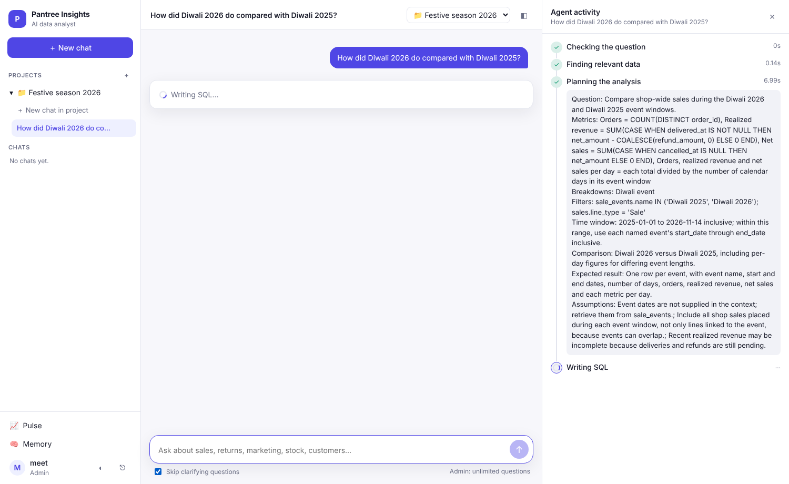
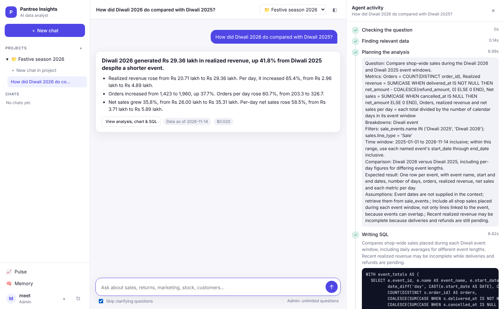
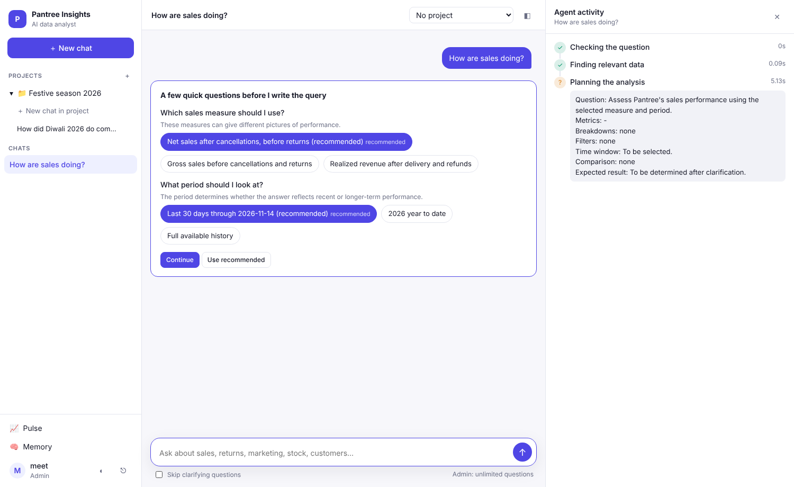
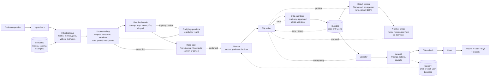

# Pantree Insights Agent

**An AI data analyst for Pantree, a simulated Indian fashion shop.** Ask a business question in plain
English; a team of agents plans the analysis, writes and checks the SQL, and turns the result into charts
and findings. It remembers what it learns, tracks the shop's KPIs day by day and points out what changed.

Data: 22 months of shop history (catalogue, customers, browsing, orders, returns, marketing, stock,
support) from my [ecommerce-simulator](https://github.com/Meetpanchal58/ecommerce-simulator), refreshed
nightly. Sister project: [pantree-recommendation-system](https://github.com/Meetpanchal58/pantree-recommendation-system).

### [▶ Live demo](https://pantree-insights-um7bylhdra-uc.a.run.app/)

Hosted on Google Cloud Run (scales to zero, so the first visit after a quiet period takes about 30 seconds).
Visitors can view recorded demo answers immediately without signing in; sign in with Google for 10 live questions a day.

> **Status:** the architecture was redesigned (data catalog, question understanding with read-back,
> code-built joins, number verification). Accuracy is measured on 148 questions with
> [the production evaluation](evals/README.md); results will be published here from that run only.


## Screenshots

| Agents working, live | Answer with plan and SQL |
|---|---|
|  |  |
| **Clarifying questions** | **Memory** |
|  |  |

## Results

Not yet measured on the current architecture. Earlier measurements were made on older designs and have been
removed so that every number here describes the system that is deployed. The production evaluation (148
questions: holdout answers, clarifying, declines, false declines, adversarial requests, over-asking, regression
and conversation flow; about US$3.5-4) is described in [evals/README.md](evals/README.md).

## The app

| Left | Middle | Right |
|---|---|---|
| Projects (with their own instructions and memory) and chats; Pulse; Memory | The conversation. Clarifying questions appear as clickable choices with a recommended default | The agents working, step by step (plan, SQL, checks), then the chart, findings, recommendations, result table and exports: **Copy, PNG, CSV, PPT, SQL** |

- **Sign-in:** Google, or a one-time code by email. Visitors who do not sign in can replay recorded demo runs
  (`demo_runs/`) at no cost; signed-in users get 10 live questions a day (admins: unlimited).
- **Memory in four levels:** the chat (follow-up questions work), the project (instructions + insights from
  its chats), the user (preferences, insights outside projects) and shared business knowledge (the business
  profile, the pulse's open gaps, and insights an admin chose to share).
- **Pulse:** this week's unusual KPI changes, each with an "Investigate" button that starts a chat.

## How it works



### Safety layers

| Layer | Role |
|---|---|
| Question check (regex) | A cheap first filter for obvious personal-data requests and prompt-injection phrasing. It can be fooled by paraphrases, so it is not relied on alone. |
| Planner | Declines personal-data requests, raw dumps and off-topic questions it recognises (judged by the model). |
| **SQL guardrails** (code) | **The real enforcement:** one read-only SELECT, approved tables and columns only (resolved against the schema), approved join paths (ON, WHERE, USING), no table functions or whole-row arguments, results summarised or limited; grouping by an identifier must be a ranked top-N. |
| **Locked database** | Blocked tables and columns do not exist in the views; the connection cannot read other files, write, install extensions or change settings. |
| Claim check | Every number in the answer is a structured claim (value, column, row, operation) recomputed from the result; free-typed numbers are rejected. |

## What is built

| Part | What it does |
|---|---|
| `semantic/schema.yaml` | The 22 tables the agent may query: grain, keys, column notes, join paths. Blocked tables and columns are listed with the reason. |
| `semantic/catalog.yaml` (`pantree-catalog`) | **Data catalog**, generated from the data and the schema: for every column its meaning, what it describes (seller, customer, order line, ...), and either every distinct value (text columns with at most 300 values, for exact filters), its format (identifiers and codes, e.g. `OD\d{9}`, `\d{6}`), its structure (names and free text: length and characters, never the values) or its range (numbers, dates). Columns with the same name in several tables are linked with their different meanings (`sellers.rating` is a seller rating, `product_reviews.rating` a review). The agent sees this for every table in its context. |
| `semantic/metrics.yaml` | **One definition per business number**: realized revenue, AOV, return rate, RTO rate, conversion, ROAS, CAC and 26 more (33 in total). The agent must use these, so "revenue" always means the same thing. |
| `semantic/examples.yaml` | 28 verified question → SQL pairs (easy to hard), used as examples and scored in the regression suite. |
| `semantic/library/` | **Query library**: 128 reference queries in 7 areas (sales, customers, funnel, marketing, inventory, delivery, support), each with other phrasings and the metrics it computes. Together with the examples they use every table, all 40 approved joins, all 33 metrics, every concept column and 25 SQL patterns (CTEs, top-N per group, cohorts, funnels, period comparisons, running totals, basket pairs, ...). Retrieval only, never scored; tests check each query passes the guardrails, runs, has no duplicate rows, computes the metrics it claims, and does not contain the answer to any scored question. `evals/library_coverage.py` reports coverage. |
| `semantic/concepts.yaml` | **What a word means depends on what the question is about.** 14 subjects (orders, sign-ups, browsing, ad spend, attribution, support, reviews, stock, ...) with their table and dates, and 33 concepts (city, region, device, channel, category, sale event, ...) mapped per subject to a column: "Mumbai" about orders is `sales.ship_city`, about sign-ups `customers.city`. Plus ID words ("order 12345" → `order_id = 'OD000012345'`). |
| `semantic/glossary.yaml` | Words people use: "cash on delivery" → `'COD'`, "shoes" → `'Footwear'`; terms such as GMV, RTO, ROAS, CAC; phrases that bring their tables ("delivery region" → `customer_addresses`). |
| `src/pantree_insights/db.py` | Downloads the shop and exposes it as DuckDB views. After setup the connection cannot read other files, write, install extensions or change settings. |
| `src/pantree_insights/guardrails.py` | Code checks (no LLM): one read-only SELECT, allowed tables, columns and joins only, no table functions, no `SELECT *` or whole-row arguments, results summarised or limited, identifier grain only as a ranked top-N; a cheap question pre-filter (explicit personal-data requests, prompt injection). |
| `src/pantree_insights/grounding.py` | Structured claims: the analyst writes `{c1}` placeholders and a claim per number; each is recomputed from the result (value, difference, ratio, share, change, sum, mean) and rendered in the text. |
| `src/pantree_insights/profile.py` | `pantree-profile`: facts measured from the data: ID formats (18 types), null shares, ranges, date coverage, and each approved join's cardinality and unmatched rows. Found that joining sales to promotions on the coupon code alone inflates coupon revenue by 7% (codes are re-issued), now a join rule the guardrail enforces. |
| `src/pantree_insights/joins.py` | Join paths built in code from the question's table to the tables it needs (bridge tables added), avoiding joins that repeat rows and flagging them when unavoidable. |
| `src/pantree_insights/understanding.py` | Turns the understanding agent's reading into exact filters, columns, time column and join path; asks the user when a word fits meanings in different groups ("Mumbai": a customer city, a seller's city, a warehouse or a brand) or a cut does not exist for the subject. |
| `src/pantree_insights/references.py`, `sqlinfo.py` | After the question is understood, picks the reference queries that use the **same tables, columns and metrics** (parsed with sqlglot), so a question worded unlike any reference still gets the right SQL pattern. |
| `src/pantree_insights/recompute.py` | **Numbers checked against the data.** Builds each metric's SQL from its `metrics.yaml` definition with code-built LEFT JOINs, independent of the LLM. Build time: 52 library queries (78 result columns) must match it row by row within 1% on the small and the full shop; the rest are marked pattern-only. Runtime: after the agent's query runs, each confirmed metric is recomputed for the confirmed scope; a mismatch goes back to the SQL writer with the recomputed numbers, a match marks the answer "Numbers verified against the data", and what cannot be recomputed is shown as "not independently verified". No false alarm on the 78 verified library columns. |
| `src/pantree_insights/checks.py` | Result checks in code, before the LLM validator: every filter the understanding resolved must be in the SQL on the right table ("sellers.city", not "customers.city"); no repeated rows; no empty columns; rates within 0-100%. Zero false alarms on the 156 reference queries; on the agent's SQL from earlier paid runs it flags 5 of 38 wrong answers and 1 of 207 correct ones. |
| `src/pantree_insights/retrieval.py` | Hybrid search (LlamaIndex: BM25 keywords + local `bge-small` embeddings, fused by reciprocal rank) over four indexes: tables, metrics, examples and ~2,000 real filter values. Returns the tables, join paths, metric definitions, exact values and similar examples a question needs, in ~60 ms. With each example held out, it finds every table the example's SQL needs for 28 of 28. |
| `prompts/agents.yaml` | The agents' instructions, editable without touching code. |
| `src/pantree_insights/agents.py` | Five agents, each one structured LLM call with a typed result: **understanding** (what exactly is asked, and every open point that would change the numbers: no fixed limit, asked round after round until nothing is unclear; a safety stop after 6 rounds; then the resolved reading is shown back in business words - measure definition, cut, period, filters - and nothing is computed until the user confirms or corrects it), **planner** (turns the understood question into an analysis plan, or declines), **SQL writer**, **validator** (does the SQL answer what was asked?) and **analyst** (headline, findings, recommendations, caveats, facts to remember). |
| `src/pantree_insights/graph.py` | The LangGraph flow: retries with the exact error when the guardrails, the database or the validator reject a query (max 3 attempts); pauses for clarifying questions and resumes with the answers; verifies every claim against the result (one rewrite, then a warning); picks a chart; saves the insight to memory only if it verified. Streams a progress event per step. |
| `src/pantree_insights/memory.py` | Saves verified answers as insights (facts with numbers, SQL and data date), finds related insights (up to 30 days old) and open gaps for new questions, and closes gaps an answer explains. |
| `src/pantree_insights/charts.py` | Picks the chart from the result's shape (line, bar, grouped bars, scatter or KPI cards) and builds Plotly JSON for the browser and exports. |
| `src/pantree_insights/web.py`, `static/` | FastAPI app and the HTML/CSS/JS front end (no build step): runs in background threads streamed over Server-Sent Events, clarifying-question pause and resume, daily limits, memory, pulse, demo replays. Exports are made in the browser (Plotly for PNG, PptxGenJS for PowerPoint). |
| `src/pantree_insights/store.py`, `auth.py` | Database (SQLite locally, Neon Postgres in production): users, projects, chats, messages, memory, sign-in codes, usage. Google OAuth and email codes with signed session cookies. |
| `src/pantree_insights/demos.py` | Records real runs and replays them with their original timing. |
| `src/pantree_insights/llm.py` | One interface to the model (LangChain `init_chat_model`, so OpenAI or Anthropic is a setting), cost per call and per question, and a daily budget stored in the database (survives restarts). Tests use a scripted fake model. |
| `src/pantree_insights/pulse.py` | Builds the daily history of 18 KPIs (143 series), compares the latest week with the 8 before it (robust z-score, Benjamini-Hochberg across series), explains changes caused by sale events and records the rest as open gaps in `memory/gaps/`. |

### Data the agent cannot see

| Hidden | Why |
|---|---|
| `customer_pii`, `customer_addresses.address_line` | Personal data |
| `support_contacts.issue_bucket_true` | Simulator ground truth a real shop would not have |
| `crm_sends` | Control-group rows have no send time, so CRM uplift cannot be measured |
| `purchase_orders` | Initial purchase orders are always recorded 2 days late |

## Quickstart

Python 3.11+ and [uv](https://docs.astral.sh/uv/).

```bash
uv sync
```

```bash
uv run pantree-data download --size full      # ~470 MB; use --size small (~170 MB) for a quick start
```

```bash
uv run pantree-data info                      # table sizes
```

```bash
uv run pantree-pulse                          # KPI history + what changed this week
```

```bash
uv run pantree-context "Is cash on delivery causing more RTO in tier 3 cities?"   # what the agent would see
```

```bash
uv run pantree-ask "How did Diwali 2026 do compared with Diwali 2025?"   # needs OPENAI_API_KEY in .env
```

A typical question takes about 20 seconds and costs about US$0.013-0.016 (about Rs 1.1-1.4) with `gpt-6.1-terra` (median and mean of the evaluation runs).

```bash
uv run pantree-web                            # the app at http://127.0.0.1:8000 (sign-in codes print in the log)
```

```bash
DATA_SIZE=small uv run python scripts/build_offline_demos.py   # rebuild the four saved demos; no model calls
```

```bash
uv run pytest -q                              # guardrail tests + checks on the small shop
```

Settings come from environment variables or `.env` (see `.env.example`), e.g. `DATA_SIZE=small`.

## Deploy

Google Cloud Run (0 instances when idle, at most 1), Neon Postgres, Google sign-in and email codes, data
mounted from Cloud Storage: step-by-step in [docs/deploy.md](docs/deploy.md). Design decisions and their
known weaknesses: [DESIGN.md](DESIGN.md).

## Evaluation

See [evals/README.md](evals/README.md): what the 148 questions test, the free checks, the paid production run and
how to read its report. Scoring (`evals/scoring.py`) aligns result rows on the business dimensions before comparing
metrics (1% tolerance), so column names do not matter but missing, extra or misplaced rows do.

## Limitations

- The data is simulated (realistic, validated), not a real shop.
- **Small holdout, written by the author.** 31 answer questions: one question moves accuracy by about 3
  points. No external questions yet; questions that informed fixes are marked `tuned_on` and reported apart.
- **Run-to-run variation.** The same question can get different SQL on different runs, so the production
  evaluation repeats the holdout answers and reports pass^k.
- **Larger prompts.** The data catalog makes table descriptions about twice as long (about 2,000 more
  tokens per call that sees the full context, roughly US$0.002-0.003 per question).
- **Same-model validator.** The validator is the same model family as the SQL writer, so it shares its
  blind spots; it catches some errors but is not an independent check.
- **Pulse raises false alerts** (about 2.8 a week on the backtest besides real changes) and misses most
  small changes; treat it as a prompt to look, not a detector.
- Answers are against one data snapshot; the simulator adds a day every night.
- **One instance by design.** Local tests use `InMemorySaver`, while Cloud Run can use
  PostgreSQL LangGraph checkpoints to resume paused clarifications after a restart. An interrupted
  *active* provider request cannot safely be replayed; the UI offers recovery instead. In-process
  SSE streams are still single-instance, so multi-instance scaling requires shared event delivery.

## Roadmap

1. ✅ Data layer, metric definitions, guardrails, KPI pulse
2. ✅ Retrieval: hybrid search (BM25 + local embeddings) over tables, metrics, examples and column values
3. ✅ Agents (planner, SQL writer, validator, analyst) as a LangGraph flow, with memory
4. ✅ FastAPI app: sign-in, chats and projects, live agent activity, charts, exports (Copy, PNG, CSV, PPT), 4-level memory, pulse, demo replays
5. ✅ Evals and deployment on Google Cloud Run (Dockerfile, `scripts/deploy_cloudrun.sh`, `evals/`)

## License

[MIT](LICENSE)

### Frontend regression checks

The browser checks use intercepted API responses and do not require sign-in, shop data or API keys.
They cover out-of-order chat requests, navigating away from streams, busy cleanup, cached revisits,
metadata caching, sidebar request counts, dismissing loading dialogs and lazy chart navigation.

```sh
npm install --no-save --package-lock=false playwright@1.62.1
npx playwright install chromium
node tests/frontend.cjs
```

The home screen has exactly four offline demos: Diwali sale comparison, brand/product sales,
conversion funnel, and marketing spend/last-click ROAS. Results come from the pinned sample snapshot,
with readable questions, SQL, findings, recommendations and limitations. They are bundled in
`static/offline-demos.js`; clicking a demo makes no model, chat API, SSE or chart-CDN requests. Once the
page assets are loaded, playback and Copy/PNG/CSV/SQL exports work without network access. Demo playback
does not write chat history or memory and cannot silently submit a live follow-up. Use New chat for live questions.
The original demo stream endpoint remains available for API clients.

The app renders the demos before waiting for sign-in/chat services. Safe GET requests retry transient
HTTP 429/502/503/504 responses at most twice within the existing request timeout, respecting Retry-After.
Long cooldowns show a disabled retry button instead of sending requests early. Recent chats are cached
briefly, and failed refreshes preserve cached conversations. Paid POST requests are never retried automatically.
Application responses include X-Request-ID; app-generated 429/503/504 responses log `request_busy` with
that reference. Upstream/Cloud Run failures can happen before the app and still require platform logs;
these recovery changes do not increase provider quotas or Cloud Run capacity.

### Reliability, feedback, and evaluation (feature branch)

- The homepage contains **four model-free offline walkthroughs** with the saved SQL, step explanations,
  preview data, charts and exports. The brand demo shows five leading brands and the five leading
  products **in each category within each brand**. These are reproducible snapshots, **not live accuracy claims**.
- Live queries use a bounded shared LLM concurrency gate. The browser preserves typed questions while
  loading, reconnects interrupted SSE streams without repeating the paid POST, and retains recent chats
  during transient 429/502/503/504 failures. These controls do **not** raise your provider/API quotas.
- User-submitted 👍/👎 feedback is stored in `feedback`; admins can inspect it using
  `GET /api/admin/feedback`. No responses are silently used as external gold evaluations.
  Stage timing, cost and result status are available for admins at `GET /api/admin/metrics`.
- `CHECKPOINT_BACKEND=postgres` uses the existing Neon database for paused LangGraph checkpoints.
  `CHECKPOINT_BACKEND=memory` remains available for local testing.
- `ENABLE_SQL_COMPILER=true` opts into a conservative code-built standard metric query path,
  falling back to the validated LLM writer for unsupported analyses. It defaults to **false** until
  a paired full-suite live evaluation confirms no quality regression.
- To evaluate the current commit, use the manually triggered **Live agent evaluation (manual, paid)**
  GitHub Action with `OPENAI_API_KEY` configured as a repository secret. It records artifacts and
  runs the suite under a spending cap. The **external holdout remains empty** until independent humans
  contribute questions and separately reviewed gold SQL; do not label self-authored tests external.
- A merge does not deploy Cloud Run. Redeploy and verify the new revision after CI and model evaluation.

### Validate changes before rollout

See [the evaluation guide](evals/README.md) for free regressions, retrieval checks, a budgeted
live-model run, independent stakeholder questions, and deployment smoke tests. The review-derived flow
suite is a regression set, not an unseen holdout. Validation failures now stop the analysis; unsupported
recomputation stays unverified, and only independently verified insights enter durable business memory.
