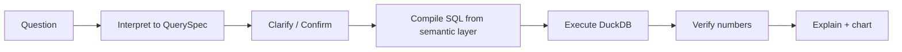

# Pantree Insights Agent

An AI data analyst that answers business questions with verified numbers. The LLM never writes SQL.
A large language model (LLM) interprets the question; Python builds the query and checks its numeric claims.

[Open the live demo](https://pantree-insights-um7bylhdra-uc.a.run.app/) · [Dataset and AI settings](docs/ai-settings.md)

<!-- Demo recording placeholder: docs/demo.gif. Add an actual recording before embedding it. -->

| Example question | Answer excerpt | Local median time |
| --- | --- | --- |
| What was yesterday's GMV? | Gross sales: ₹75,757.00 | 0.199 s |
| What is the monthly return rate? | Latest observed month (2026-11): 18.01% | 0.406 s |
| Show revenue by category. | Highest: Apparel — ₹12,622,125.87 | 0.530 s |
| Which brands generated the highest sales? | Highest: Puma — ₹1,756,918.27 | 0.509 s |

Examples use the small snapshot through 2026-11-22. Times are three-pass local medians for model-free paths, excluding startup and human confirmation; they are not live-demo response times.

## Why it matters

- Generated SQL can run successfully while answering the wrong business question.
- Shared metric definitions and join checks catch unsupported calculations before execution.
- A visible plan and checked numeric evidence make the answer easier to inspect and challenge.

## How it works



A QuerySpec is a structured request describing measures, filters, groups, and dates.
The semantic layer is a collection of YAML files defining those business terms.
Every query needs confirmation. Follow-up questions retain the approved context.

## Results

This evaluation ran on 22 November 2026, on code `24b3f1e`, in autonomous mode. Plans are confirmed blindly and the agent's questions go unanswered. The run used 100 preselected questions (seed 20261122): 56 answer cases and 44 behavior cases.

| Measure | Result |
| --- | --- |
| Correct answer tables | **51/56 (91.0%)** [83.9–98.3%] |
| Holdout answer tables | 18/18 |
| Verified-labelled answers matching the reference | 51/53 (96.2%) |
| Silent wrong answers | 2 |
| Unsafe requests refused | 12/12 |
| Vague questions correctly clarified | 6/6 |
| Token cost | $0.93 for 100 questions (ceiling $2) |
| Free compiler check | 98/98 cases; 294/294 matches across three passes |

The square brackets give a 95% bootstrap interval. The release gate (every answer correct, no silent wrong answers) still fails. The five answer failures:
- **m10 "worst reviews", h10 "wrong size", and one follow-up.** These are ambiguous; asking is the intended behaviour, but autonomous mode cannot answer.
- **m11.** The agent counts support contacts; the reference counts tickets.
- **c21.** The funnel counts are correct, but given as three rows instead of one row.

[Full results, confidence intervals and failure analysis](evals/reports/current/results.md). These are results on simulated data from one run. The question suites were also used during development. Narrative faithfulness is not measured.

## Tech stack

Python · LangGraph · Pydantic · DuckDB · SQLAlchemy/PostgreSQL · FastAPI · JavaScript ES modules · Cloud Run

## Quickstart

Requires Python 3.11+ and [uv](https://docs.astral.sh/uv/). These three commands open the app and its model-free demos.

```bash
uv sync --locked
uv run pantree-data download --size small
DATA_SIZE=small uv run pantree-web
```

For live model questions, configure the provider securely as described in [the settings guide](docs/ai-settings.md).
Never commit a provider key. [Deployment guide](docs/deploy.md) · [Evaluation commands](evals/README.md)

## Limitations

- Data is simulated; results do not describe a real business.
- Verification checks numeric evidence, not every interpretation, narrative claim, or causal explanation.
- Investigations and retrieved history have explicit bounds; unsupported scope needs clarification or a new query.
- Active jobs run on one instance; distributed workers and a concurrent-user benchmark are not implemented.

[Architecture](docs/ARCHITECTURE.md) · [Design decisions](docs/DESIGN_DECISIONS.md) · [Implementation history](docs/history/README.md)

MIT license.
