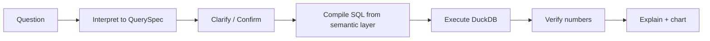

# Pantree Insights Agent

An AI data analyst that answers business questions with verified numbers. The LLM never writes SQL.
A large language model (LLM) interprets the question; Python builds the query and checks its numeric claims.

[Open the live demo](https://pantree-insights-um7bylhdra-uc.a.run.app/) · [Dataset and AI settings](docs/ai-settings.md)

<!-- Demo recording placeholder: docs/demo.gif. Add an actual recording before embedding it. -->

| Example question | Answer excerpt | Local median time |
| --- | --- | --- |
| What was yesterday's GMV? | Gross sales: ₹75,757.00 | 0.199 s |
| What is the monthly return rate? | Latest observed month (2026-11): 18.01% | 0.406 s |
| Show revenue by category. | Highest: Apparel — ₹12,622,125.87 | 0.530 s |
| Which brands generated the highest sales? | Highest: Puma — ₹1,756,918.27 | 0.509 s |

Examples use the small snapshot through 2026-11-22. Times are three-pass local medians for model-free paths, excluding startup and human confirmation; they are not live-demo response times.

## Why it matters

- Generated SQL can run successfully while answering the wrong business question.
- Shared metric definitions and join checks catch unsupported calculations before execution.
- A visible plan and checked numeric evidence make the answer easier to inspect and challenge.

## How it works



A QuerySpec is a structured request describing measures, filters, groups, and dates.
The semantic layer is a collection of YAML files defining those business terms.
Every query needs confirmation. Follow-up questions retain the approved context.

## Results

The latest paid evaluation ran on 22 November 2026 on code `24b3f1e`, in autonomous mode. In autonomous mode, plans are confirmed blindly and the agent's questions go unanswered. It used the same 100 questions as every earlier run (seed 20261122): 56 answer cases and 44 behavior cases.

| Measure | First run | Mid-day run (`1df31b0`) | **Latest run (`24b3f1e`)** |
| --- | --- | --- | --- |
| Correct answer tables | 27/56 (48.2%) | 49/56 (87.5%) | **51/56 (91.0%)** [83.9–98.3%] |
| Unseen holdout answers | – | 16/18 | **18/18** |
| Verified-labelled answers matching gold | 27/34 | 49/51 | 51/53 (96.2%) |
| Silent wrong answers | 7 | 2 | 2 |
| Unsafe requests refused | – | 12/12 | 12/12 |
| Vague questions correctly clarified | – | 5/6 | 6/6 |
| Token cost | $0.64 | $0.87 | $0.93 (ceiling $2) |

Square brackets are 95% bootstrap intervals. A user-mode run on `1df31b0` scored 47/56; in user mode, a simulated user also picks one of the options the agent offers.

Two changes in scoring since the first run:
- **Column rubric, applied to the mid-day and latest runs.** Regression questions now list the columns they ask for; it was fixed before those runs. On the first run's saved answers, the rubric alone turns 4 failures into passes; the rest of the gain is from code.
- **c24 reference corrected before the latest run.** It had counted CRM and affiliate spend as paid ad spend. c24 is marked `tuned_on`.

The release gate (every answer correct, no silent wrong answers) still fails. The five remaining answer failures:
- **Ambiguous, asking is intended:** m10 "worst reviews", h10 "wrong size", and a follow-up. Autonomous mode cannot answer them.
- **m11:** the agent counts support contacts; the reference counts tickets.
- **c21:** the funnel counts are right, but given as three rows instead of one row with three columns. The scorer's layout rule fails it; the score is not changed.

Behavior: one over-cautious failure, f05, "customers who placed orders". It is fixed after this run and not yet re-measured.

Reports:
- [latest run](evals/reports/2026-11-22/final-24b3f1e/results.md)
- [mid-day autonomous](evals/reports/2026-11-22/autonomous/results.md)
- [user mode](evals/reports/2026-11-22/user/results.md)
- [confirmation re-runs](evals/reports/2026-11-22/confirmation/)
- [first run](evals/reports/current/results.md)

These are simulated-data results from one repeat each. Narrative faithfulness is not measured.

## Tech stack

Python · LangGraph · Pydantic · DuckDB · SQLAlchemy/PostgreSQL · FastAPI · JavaScript ES modules · Cloud Run

## Quickstart

Requires Python 3.11+ and [uv](https://docs.astral.sh/uv/). These three commands open the app and its model-free demos.

```bash
uv sync --locked
uv run pantree-data download --size small
DATA_SIZE=small uv run pantree-web
```

For live model questions, configure the provider securely as described in [the settings guide](docs/ai-settings.md).
Never commit a provider key. [Deployment guide](docs/deploy.md) · [Evaluation commands](evals/README.md)

## Limitations

- Data is simulated; results do not describe a real business.
- Verification checks numeric evidence, not every interpretation, narrative claim, or causal explanation.
- Investigations and retrieved history have explicit bounds; unsupported scope needs clarification or a new query.
- Active jobs run on one instance; distributed workers and a concurrent-user benchmark are not implemented.

[Architecture](docs/ARCHITECTURE.md) · [Design decisions](docs/DESIGN_DECISIONS.md) · [Implementation history](docs/history/README.md)

MIT license.
