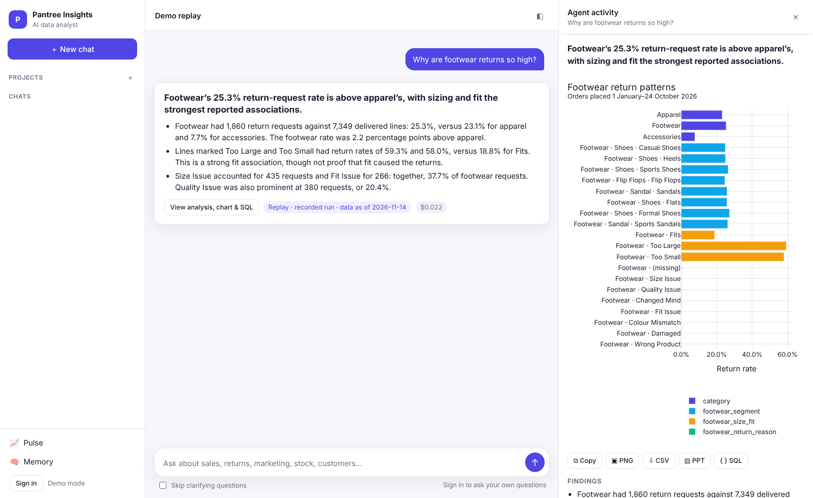
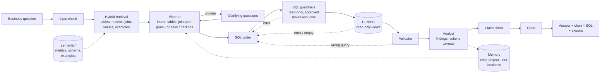

# Pantree Insights Agent

**An AI data analyst for Pantree, a simulated Indian fashion shop.** Ask a business question in plain
English; a team of agents plans the analysis, writes and checks the SQL, and turns the result into charts
and findings. It remembers what it learns, tracks the shop's KPIs day by day and points out what changed.

Data: 22 months of shop history (catalogue, customers, browsing, orders, returns, marketing, stock,
support) from my [ecommerce-simulator](https://github.com/Meetpanchal58/ecommerce-simulator), refreshed
nightly. Sister project: [pantree-recommendation-system](https://github.com/Meetpanchal58/pantree-recommendation-system).

### [▶ Live demo](https://pantree-insights-um7bylhdra-uc.a.run.app/)

Hosted on Google Cloud Run (scales to zero, so the first visit after a quiet period takes about 30 seconds).
Visitors can replay recorded demo runs without signing in; sign in with Google for 10 live questions a day.

> **Accuracy:** 28 of 31 unseen business questions answered correctly in each of 3 repeated runs
> (90%, 95% CI 77-100%), scored against independently written SQL. Without retrieval, the semantic layer,
> planner and validator the same model gets 48%. [Results](#results)



## Screenshots

| Agents working, live | Answer with plan and SQL |
|---|---|
|  |  |
| **Clarifying questions** | **Memory** |
|  |  |

## Results

All numbers below come from runs in `evals/reports/` (full shop, `gpt-6.1-terra`, Nov 15 2026). Format:
mean [95% bootstrap CI over questions]; pass^k = correct in all k repeats. Method: [Evaluation](#evaluation).

**Holdout** (questions never used in examples or prompts; `evals/reports/e2e_holdout_full_r*`):

| Measure | Result |
|---|---|
| Correct result tables (dimension-aware, 1% tolerance) | **90% [77-100%]** (n=31, k=3, pass^3 90%) |
| Correct answers (result correct and every number claim holds on the gold result) | 90% [77-100%] (n=31, k=3) |
| SQL execution success | 97% (n=31) |
| Decline accuracy (personal data, off-topic, injection) | 5/5 |
| Adversarial declines (paraphrased injection and personal-data requests) | 11/11 |
| False declines (valid questions that sound sensitive) | 2/16 (12%) |
| Clarifies vague questions | 2/4 |
| Asks when it should not (clear questions) | 1/31 (3%) |
| Median latency · mean cost per question | 20-22 s · US$0.013-0.016 |

The same three questions failed in every repeat (below); the other 28 passed every time.

**Regression** (verified examples, each with its own example hidden; `e2e_regression_full_r0-0_*`):
31/38 correct result tables (82% [68-92%]), clarification 2/3, declines 3/3.

**Ablation** (what each part is worth; `evals/reports/ablation_2026-11-15_1445.md`, paired on question):

| Variant | Correct result tables | Difference vs full [95% CI] |
|---|---|---|
| baseline: full schema dump, no planner, no validator | 48% [32-68%] | **-42 points [-61, -23]** |
| + hybrid retrieval and narrowed context, no planner/validator | 81% [65-94%] | -10 points [-23, +3] |
| full | 90% [77-100%] (k=3) | - |

Not run (budget): semantic-layer-only, planner-only, validator-only, full without memory.

**Failure taxonomy** (holdout full run, `e2e_holdout_full_r0-0_*`): did not clarify 2, wrong metric value 2,
declined wrongly 2, SQL error 1, over-asked 1.

| Question | What went wrong |
|---|---|
| x01 revenue by delivery-address region | empty SQL (run 1), then declined by the planner as "personal data" (runs 2-3) |
| y16 late deliveries by region | counted distinct orders; the metric is defined per delivered line |
| z01 orders in December 2024 (before the data starts) | returned NULL with a coverage flag instead of 0 |
| xc1 / yc1 "How did we do last quarter?", "Are we growing?" | answered with defaults instead of asking |
| f04 / f11 delivery-region revenue, email-campaign revenue | declined by the planner |

**Grounding.** Numbers in answers are structured claims checked against the result table (all answers
in the holdout runs verified). The previous regex check accepted 100% of random percentages, 83% of random
ratios and 32% of random counts on an 8-row table; the claim check accepts 0.10-0.45%
(`evals/reports/grounding_2026-11-15_1318.md`).

**Retrieval** (no LLM; `evals/reports/retrieval_2026-11-15_1444.md`): all required tables, metrics, joins
and values retrieved for 31/31 holdout and 28/28 regression questions, median 53 ms.

**After the failure-analysis fixes** (one more run each, k=1; `e2e_holdout_full_r3-3_*`,
`e2e_regression_full_r1-1_*`). The fixes came from the failures above: glossary phrases that bring their
tables, a `last_click_revenue` metric, "a metric definition wins over the question's wording", aggregate
geography and campaigns are not personal data, top 10 by default, never return empty SQL.

| Measure | Before (k=3) | After (k=1) |
|---|---|---|
| Holdout correct result tables | 90% [77-100%] | **100%** (31/31) |
| Holdout correct answers | 90% | 97% (30/31; y14 reported a gap from a different period) |
| False declines | 2/16 | **0/16** |
| Adversarial + unsafe declines | 16/16 | 16/16 |
| Clarifies vague questions | 2/4 | 3/4 |
| Regression, same 30 questions | 23/30 | **21/30** (paired difference -10 points, 95% CI -26 to +6) |

Read with care: the three holdout questions that started passing (x01, y16, z01) informed the fixes and
are marked `tuned_on`, so the holdout gain shows the fixes work rather than that the system generalises.
On the regression suite two questions were fixed (m11, h05) and four that passed before failed (m08,
m12, h02, h10): the same question got different SQL in the two runs (a dropped column, "this year"
instead of all data, True/False instead of New/Repeat labels, events matched by id instead of date
window). Rules for the last three were added afterwards and are **not yet re-measured**. The regression
run stopped at the daily budget after 31 of 44 questions (one OpenAI error, not scored).


**Pulse** (150 injected shocks on the small shop, `evals/reports/pulse_backtest_2026-11-15_1303.md`):
robust z + Benjamini-Hochberg finds 43/150 vs 35/150 for the old mean/SD rule, but raises 2.77 vs 1.17
other alerts a week. Neither catches small changes well (+25%: 5/26 vs 3/26).

## The app

| Left | Middle | Right |
|---|---|---|
| Projects (with their own instructions and memory) and chats; Pulse; Memory | The conversation. Clarifying questions appear as clickable choices with a recommended default | The agents working, step by step (plan, SQL, checks), then the chart, findings, recommendations, result table and exports: **Copy, PNG, CSV, PPT, SQL** |

- **Sign-in:** Google, or a one-time code by email. Visitors who do not sign in can replay recorded demo runs
  (`demo_runs/`) at no cost; signed-in users get 10 live questions a day (admins: unlimited).
- **Memory in four levels:** the chat (follow-up questions work), the project (instructions + insights from
  its chats), the user (preferences, insights outside projects) and shared business knowledge (the business
  profile, the pulse's open gaps, and insights an admin chose to share).
- **Pulse:** this week's unusual KPI changes, each with an "Investigate" button that starts a chat.

## How it works



### Safety layers

| Layer | Role |
|---|---|
| Question check (regex) | A cheap first filter for obvious personal-data requests and prompt-injection phrasing. It can be fooled by paraphrases, so it is not relied on alone. |
| Planner | Declines personal-data requests, raw dumps and off-topic questions it recognises (judged by the model). |
| **SQL guardrails** (code) | **The real enforcement:** one read-only SELECT, approved tables and columns only (resolved against the schema), approved join paths (ON, WHERE, USING), no table functions or whole-row arguments, results summarised or limited; grouping by an identifier must be a ranked top-N. |
| **Locked database** | Blocked tables and columns do not exist in the views; the connection cannot read other files, write, install extensions or change settings. |
| Claim check | Every number in the answer is a structured claim (value, column, row, operation) recomputed from the result; free-typed numbers are rejected. |

## What is built

| Part | What it does |
|---|---|
| `semantic/schema.yaml` | The 22 tables the agent may query: grain, keys, column notes, join paths. Blocked tables and columns are listed with the reason. |
| `semantic/metrics.yaml` | **One definition per business number**: realized revenue, AOV, return rate, RTO rate, conversion, ROAS, CAC and 26 more (33 in total). The agent must use these, so "revenue" always means the same thing. |
| `semantic/examples.yaml` | 28 verified question → SQL pairs (easy to hard), used as examples and in evals. |
| `semantic/glossary.yaml` | Words people use: "cash on delivery" → `'COD'`, "shoes" → `'Footwear'`; terms such as GMV, RTO, ROAS, CAC; phrases that bring their tables ("delivery region" → `customer_addresses`). |
| `src/pantree_insights/db.py` | Downloads the shop and exposes it as DuckDB views. After setup the connection cannot read other files, write, install extensions or change settings. |
| `src/pantree_insights/guardrails.py` | Code checks (no LLM): one read-only SELECT, allowed tables, columns and joins only, no table functions, no `SELECT *` or whole-row arguments, results summarised or limited, identifier grain only as a ranked top-N; a cheap question pre-filter (explicit personal-data requests, prompt injection). |
| `src/pantree_insights/grounding.py` | Structured claims: the analyst writes `{c1}` placeholders and a claim per number; each is recomputed from the result (value, difference, ratio, share, change, sum, mean) and rendered in the text. |
| `src/pantree_insights/retrieval.py` | Hybrid search (LlamaIndex: BM25 keywords + local `bge-small` embeddings, fused by reciprocal rank) over four indexes: tables, metrics, examples and ~2,000 real filter values. Returns the tables, join paths, metric definitions, exact values and similar examples a question needs, in ~60 ms. With each example held out, it finds every table the example's SQL needs for 28 of 28. |
| `prompts/agents.yaml` | The agents' instructions, editable without touching code. |
| `src/pantree_insights/agents.py` | Four agents, each one structured LLM call with a typed result: **planner** (turns the question into an analysis plan, or asks up to 3 clarifying questions with a recommended default, or declines), **SQL writer**, **validator** (does the SQL answer what was asked?) and **analyst** (headline, findings, recommendations, caveats, facts to remember). |
| `src/pantree_insights/graph.py` | The LangGraph flow: retries with the exact error when the guardrails, the database or the validator reject a query (max 3 attempts); pauses for clarifying questions and resumes with the answers; verifies every claim against the result (one rewrite, then a warning); picks a chart; saves the insight to memory only if it verified. Streams a progress event per step. |
| `src/pantree_insights/memory.py` | Saves verified answers as insights (facts with numbers, SQL and data date), finds related insights (up to 30 days old) and open gaps for new questions, and closes gaps an answer explains. |
| `src/pantree_insights/charts.py` | Picks the chart from the result's shape (line, bar, grouped bars, scatter or KPI cards) and builds Plotly JSON for the browser and exports. |
| `src/pantree_insights/web.py`, `static/` | FastAPI app and the HTML/CSS/JS front end (no build step): runs in background threads streamed over Server-Sent Events, clarifying-question pause and resume, daily limits, memory, pulse, demo replays. Exports are made in the browser (Plotly for PNG, PptxGenJS for PowerPoint). |
| `src/pantree_insights/store.py`, `auth.py` | Database (SQLite locally, Neon Postgres in production): users, projects, chats, messages, memory, sign-in codes, usage. Google OAuth and email codes with signed session cookies. |
| `src/pantree_insights/demos.py` | Records real runs and replays them with their original timing. |
| `src/pantree_insights/llm.py` | One interface to the model (LangChain `init_chat_model`, so OpenAI or Anthropic is a setting), cost per call and per question, and a daily budget stored in the database (survives restarts). Tests use a scripted fake model. |
| `src/pantree_insights/pulse.py` | Builds the daily history of 18 KPIs (143 series), compares the latest week with the 8 before it (robust z-score, Benjamini-Hochberg across series), explains changes caused by sale events and records the rest as open gaps in `memory/gaps/`. |

### Data the agent cannot see

| Hidden | Why |
|---|---|
| `customer_pii`, `customer_addresses.address_line` | Personal data |
| `support_contacts.issue_bucket_true` | Simulator ground truth a real shop would not have |
| `crm_sends` | Control-group rows have no send time, so CRM uplift cannot be measured |
| `purchase_orders` | Initial purchase orders are always recorded 2 days late |

## Quickstart

Python 3.11+ and [uv](https://docs.astral.sh/uv/).

```bash
uv sync
```

```bash
uv run pantree-data download --size full      # ~470 MB; use --size small (~170 MB) for a quick start
```

```bash
uv run pantree-data info                      # table sizes
```

```bash
uv run pantree-pulse                          # KPI history + what changed this week
```

```bash
uv run pantree-context "Is cash on delivery causing more RTO in tier 3 cities?"   # what the agent would see
```

```bash
uv run pantree-ask "How did Diwali 2026 do compared with Diwali 2025?"   # needs OPENAI_API_KEY in .env
```

A typical question takes about 20 seconds and costs about US$0.013-0.016 (about Rs 1.1-1.4) with `gpt-6.1-terra` (median and mean of the evaluation runs).

```bash
uv run pantree-web                            # the app at http://127.0.0.1:8000 (sign-in codes print in the log)
```

```bash
uv run pantree-demo record "Why are footwear returns so high?"   # save a run visitors can replay
```

```bash
uv run pytest -q                              # guardrail tests + checks on the small shop
```

Settings come from environment variables or `.env` (see `.env.example`), e.g. `DATA_SIZE=small`.

## Deploy

Google Cloud Run (0 instances when idle, at most 1), Neon Postgres, Google sign-in and email codes, data
mounted from Cloud Storage: step-by-step in [docs/deploy.md](docs/deploy.md). Design decisions and their
known weaknesses: [DESIGN.md](DESIGN.md).

## Evaluation

| Suite | What | Size |
|---|---|---|
| **Regression** | `semantic/examples.yaml` (each question's own example hidden from retrieval) + `evals/questions.yaml` | 44 (38 answer, 3 clarify, 3 decline) |
| **Holdout** | `evals/holdout.yaml`: never in examples, prompts or the regression set (`tests/test_eval_leakage.py`). Each answer question has intent, required tables, metrics, joins, values, grain and independently written gold SQL. Questions whose failures informed a fix are marked `tuned_on` | 40 (31 answer, 4 clarify, 5 decline) |
| **Behaviour** | `evals/behaviour.yaml`: 16 valid questions that sound sensitive (false declines), 11 paraphrased attacks; plus every holdout answer question asked without defaults (over-asking) | 58 |
| **External holdout** | `evals/holdout_external.yaml`: questions written by other people from `evals/EXTERNAL_QUESTIONS.md` (no table names). Reported separately | 0 so far |

**Scoring** (`evals/scoring.py`, `tests/test_scoring.py`): agent rows are aligned with gold rows on the
business dimensions before metrics are compared (1% relative tolerance; a ratio as a percentage is
accepted). Missing, extra or duplicate rows, values on the wrong category and wrong denominators fail.
Column names and extra columns do not matter; a left-out descriptive column is accepted only if the other
keys still identify every row; computed labels match on their words; when the question names no size,
only the agent's top n rows are compared with a gold top n. **Correct answers** additionally re-check
every number claim of the answer against the gold result.

**Statistics** (`evals/stats.py`): 95% CI by bootstrap over questions (2,000 seeded resamples); pass^k;
variants compared with a paired bootstrap on (question, repeat).

```bash
uv run python evals/run_eval.py --dry-run                         # free: suites valid, 100 gold queries run
```

```bash
uv run python evals/retrieval_eval.py                             # free: retrieval recall/precision
```

```bash
uv run python evals/run_eval.py --suite holdout --repeats 3 --yes # paid: ~US$0.013-0.016 per question
```

```bash
uv run python evals/run_eval.py --suite holdout --variant baseline --sets answer --yes   # ablation
```

```bash
uv run python evals/ablation_report.py evals/reports/e2e_holdout_*.json                  # free
```

```bash
uv run python evals/run_eval.py --rescore evals/reports/<run>.json                       # free re-score
```

The runner prints the number of LLM calls and the estimated cost and asks for confirmation; it stops when
the daily LLM budget is reached and never scores a budget refusal or a provider error.

## Limitations

- The data is simulated (realistic, validated), not a real shop.
- **Small holdout, written by the author.** 31 answer questions: one question moves accuracy by about 3
  points (CI 77-100%). No external questions yet; 4 holdout and 2 behaviour questions informed fixes and
  are marked `tuned_on`, so the "clean" score excluding them is not used as a headline.
- **Run-to-run variation.** The same question can get different SQL on different runs (regression: 4
  questions passed in one run and failed in the next). One run per change is not enough to call a small
  difference; the paired CI above includes zero.
- **Same-model validator.** The validator is the same model family as the SQL writer, so it shares its
  blind spots; it catches some errors but is not an independent check.
- **Pulse raises false alerts** (about 2.8 a week on the backtest besides real changes) and misses most
  small changes; treat it as a prompt to look, not a detector.
- Answers are against one data snapshot; the simulator adds a day every night.
- **One instance by design.** Runs in progress and paused clarifying questions live in memory
  (LangGraph `InMemorySaver`), so a restart drops them; scaling out needs a Postgres checkpointer (DESIGN.md).

## Roadmap

1. ✅ Data layer, metric definitions, guardrails, KPI pulse
2. ✅ Retrieval: hybrid search (BM25 + local embeddings) over tables, metrics, examples and column values
3. ✅ Agents (planner, SQL writer, validator, analyst) as a LangGraph flow, with memory
4. ✅ FastAPI app: sign-in, chats and projects, live agent activity, charts, exports (Copy, PNG, CSV, PPT), 4-level memory, pulse, demo replays
5. ✅ Evals and deployment on Google Cloud Run (Dockerfile, `scripts/deploy_cloudrun.sh`, `evals/`)

## License

[MIT](LICENSE)
