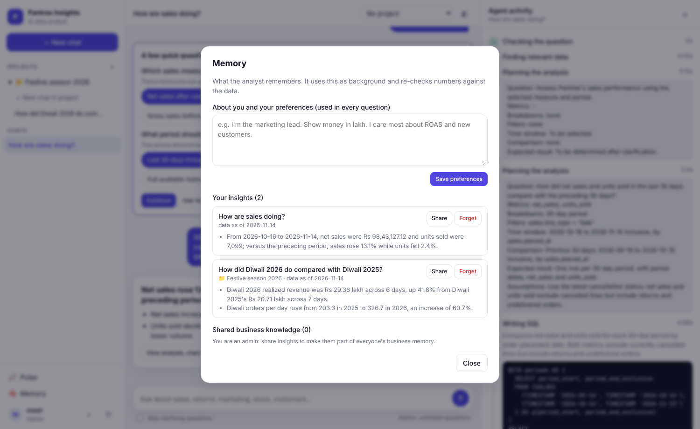
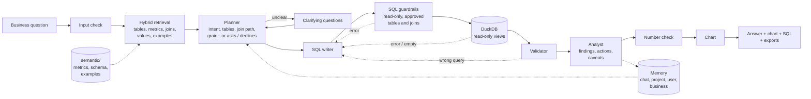

# Pantree Insights Agent

**An AI data analyst for Pantree, a simulated Indian fashion shop.** Ask a business question in plain
English; a team of agents plans the analysis, writes and checks the SQL, and turns the result into charts
and findings. It remembers what it learns, tracks the shop's KPIs day by day and points out what changed.

Data: 22 months of shop history (catalogue, customers, browsing, orders, returns, marketing, stock,
support) from my [ecommerce-simulator](https://github.com/Meetpanchal58/ecommerce-simulator), refreshed
nightly. Sister project: [pantree-recommendation-system](https://github.com/Meetpanchal58/pantree-recommendation-system).

### [▶ Live demo](https://pantree-insights-um7bylhdra-uc.a.run.app/)

Hosted on Google Cloud Run (scales to zero, so the first visit after a quiet period takes about 30 seconds).
Visitors can replay recorded demo runs without signing in; sign in with Google for 10 live questions a day.

> **Accuracy:** 28 of 30 unseen business questions answered correctly on the holdout, scored against
> independently written SQL ([Evaluation](#evaluation)).


## Screenshots

| Agents working, live | Answer with plan and SQL |
|---|---|
|  |  |
| **Clarifying questions** | **Memory** |
|  |  |

## The app

| Left | Middle | Right |
|---|---|---|
| Projects (with their own instructions and memory) and chats; Pulse; Memory | The conversation. Clarifying questions appear as clickable choices with a recommended default | The agents working, step by step (plan, SQL, checks), then the chart, findings, recommendations, result table and exports: **Copy, PNG, CSV, PPT, SQL** |

- **Sign-in:** Google, or a one-time code by email. Visitors who do not sign in can replay recorded demo runs
  (`demo_runs/`) at no cost; signed-in users get 10 live questions a day (admins: unlimited).
- **Memory in four levels:** the chat (follow-up questions work), the project (instructions + insights from
  its chats), the user (preferences, insights outside projects) and shared business knowledge (the business
  profile, the pulse's open gaps, and insights an admin chose to share).
- **Pulse:** this week's unusual KPI changes, each with an "Investigate" button that starts a chat.

## How it works



### Safety layers

| Layer | Role |
|---|---|
| Question check (regex) | A cheap first filter for obvious personal-data requests and prompt-injection phrasing. It can be fooled by paraphrases, so it is not relied on alone. |
| Planner | Declines personal-data requests, raw dumps and off-topic questions it recognises (judged by the model). |
| **SQL guardrails** (code) | **The real enforcement:** one read-only SELECT, approved tables and columns only, approved join paths, no table functions, results summarised or limited. |
| **Locked database** | Blocked tables and columns do not exist in the views; the connection cannot read other files, write, install extensions or change settings. |
| Number check | Every number in the answer must come from the result (or a simple derivation of it). |

## What is built

| Part | What it does |
|---|---|
| `semantic/schema.yaml` | The 22 tables the agent may query: grain, keys, column notes, join paths. Blocked tables and columns are listed with the reason. |
| `semantic/metrics.yaml` | **One definition per business number**: realized revenue, AOV, return rate, RTO rate, conversion, ROAS, CAC and 25 more (32 in total). The agent must use these, so "revenue" always means the same thing. |
| `semantic/examples.yaml` | 28 verified question → SQL pairs (easy to hard), used as examples and in evals. |
| `semantic/glossary.yaml` | Words people use: "cash on delivery" → `'COD'`, "shoes" → `'Footwear'`, and terms such as GMV, RTO, ROAS, CAC. |
| `src/pantree_insights/db.py` | Downloads the shop and exposes it as DuckDB views. After setup the connection cannot read other files, write, install extensions or change settings. |
| `src/pantree_insights/guardrails.py` | Code checks (no LLM): one read-only SELECT, allowed tables and columns only, no table functions, no `SELECT *`, results must be summarised or limited; question checks (personal data, prompt injection); and a check that every number in an answer comes from the query result. |
| `src/pantree_insights/retrieval.py` | Hybrid search (LlamaIndex: BM25 keywords + local `bge-small` embeddings, fused by reciprocal rank) over four indexes: tables, metrics, examples and ~2,000 real filter values. Returns the tables, join paths, metric definitions, exact values and similar examples a question needs, in ~60 ms. With each example held out, it finds every table the example's SQL needs for 28 of 28. |
| `prompts/agents.yaml` | The agents' instructions, editable without touching code. |
| `src/pantree_insights/agents.py` | Four agents, each one structured LLM call with a typed result: **planner** (turns the question into an analysis plan, or asks up to 3 clarifying questions with a recommended default, or declines), **SQL writer**, **validator** (does the SQL answer what was asked?) and **analyst** (headline, findings, recommendations, caveats, facts to remember). |
| `src/pantree_insights/graph.py` | The LangGraph flow: retries with the exact error when the guardrails, the database or the validator reject a query (max 3 attempts); pauses for clarifying questions and resumes with the answers; checks every number in the answer against the result; picks a chart; saves the insight to memory. Streams a progress event per step. |
| `src/pantree_insights/memory.py` | Saves each answer as an insight (facts with numbers, SQL and data date), finds related insights and open gaps for new questions, and closes gaps an answer explains. |
| `src/pantree_insights/charts.py` | Picks the chart from the result's shape (line, bar, grouped bars, scatter or KPI cards) and builds Plotly JSON for the browser and exports. |
| `src/pantree_insights/web.py`, `static/` | FastAPI app and the HTML/CSS/JS front end (no build step): runs in background threads streamed over Server-Sent Events, clarifying-question pause and resume, daily limits, memory, pulse, demo replays. Exports are made in the browser (Plotly for PNG, PptxGenJS for PowerPoint). |
| `src/pantree_insights/store.py`, `auth.py` | Database (SQLite locally, Neon Postgres in production): users, projects, chats, messages, memory, sign-in codes, usage. Google OAuth and email codes with signed session cookies. |
| `src/pantree_insights/demos.py` | Records real runs and replays them with their original timing. |
| `src/pantree_insights/llm.py` | One interface to the model (LangChain `init_chat_model`, so OpenAI or Anthropic is a setting), cost per call and per question, and a daily budget stored in the database (survives restarts). Tests use a scripted fake model. |
| `src/pantree_insights/pulse.py` | Builds the daily history of 18 KPIs (143 series), compares the latest week with the 8 before it, explains changes caused by sale events and records the rest as open gaps in `memory/gaps/`. |

### Data the agent cannot see

| Hidden | Why |
|---|---|
| `customer_pii`, `customer_addresses.address_line` | Personal data |
| `support_contacts.issue_bucket_true` | Simulator ground truth a real shop would not have |
| `crm_sends` | Control-group rows have no send time, so CRM uplift cannot be measured |
| `purchase_orders` | Initial purchase orders are always recorded 2 days late |

## Quickstart

Python 3.11+ and [uv](https://docs.astral.sh/uv/).

```bash
uv sync
```

```bash
uv run pantree-data download --size full      # ~470 MB; use --size small (~170 MB) for a quick start
```

```bash
uv run pantree-data info                      # table sizes
```

```bash
uv run pantree-pulse                          # KPI history + what changed this week
```

```bash
uv run pantree-context "Is cash on delivery causing more RTO in tier 3 cities?"   # what the agent would see
```

```bash
uv run pantree-ask "How did Diwali 2026 do compared with Diwali 2025?"   # needs OPENAI_API_KEY in .env
```

A typical question takes 30-50 seconds and costs about Rs 2-3 (US$0.02-0.04) with `gpt-6.1-terra`.

```bash
uv run pantree-web                            # the app at http://127.0.0.1:8000 (sign-in codes print in the log)
```

```bash
uv run pantree-demo record "Why are footwear returns so high?"   # save a run visitors can replay
```

```bash
uv run pytest -q                              # guardrail tests + checks on the small shop
```

Settings come from environment variables or `.env` (see `.env.example`), e.g. `DATA_SIZE=small`.

## Deploy on Google Cloud Run

Everything below runs in **Google Cloud Shell** (the terminal button at the top right of the Google Cloud
console): it is already signed in and has `gcloud`, `git` and bash. Settings keep it inside the free tier:
**0 instances when idle, at most 1**, request-based billing, data mounted from Cloud Storage.

**1. Database (Neon Postgres, free).** Create a project at neon.tech, copy the connection string
(`postgresql://...?sslmode=require`) and store it as a secret (Cloud console → Secret Manager → Create secret,
name `database-url`). Tables are created automatically on first start.

**2. Google sign-in (optional but recommended).** Cloud console → APIs & Services → OAuth consent screen
(External; app name "Pantree Insights"; scopes `openid`, `email`, `profile`; publish the app) → Credentials →
Create credentials → OAuth client ID → Web application. Leave the redirect URI for now (step 5).
Store the ID and secret as secrets `google-client-id` and `google-client-secret`.
For email codes instead or as well: a Gmail app password, stored as `smtp-username` and `smtp-password`.

**3. Get the code and upload the data** (once, and again whenever you want fresher data):

```bash
git clone https://github.com/Meetpanchal58/pantree-insights-agent && cd pantree-insights-agent
```

```bash
bash scripts/upload_data.sh
```

**4. Deploy** (the OpenAI key is already in Secret Manager as `openai-api-key`):

```bash
ADMIN_EMAIL=you@gmail.com bash scripts/deploy_cloudrun.sh
```

The script creates a service account that can only read the secrets and the data bucket, builds the image
with Cloud Build, deploys, and prints the live URL.

**5. Finish Google sign-in:** add the printed redirect URI (`<URL>/auth/google/callback`) to the OAuth client's
"Authorized redirect URIs". Redeploy any time with the same command.

**6. Automatic deploys (optional, once).** A Cloud Build trigger can deploy every push to `main` with
`cloudbuild.yaml` (build → push → `gcloud run deploy --image`; secrets, data bucket and settings stay as the
script set them). In the Cloud console of this project:

- **Cloud Build → Permissions:** choose the Compute Engine default service account, turn on
  "Set as pre-selected for new triggers", and enable **Cloud Run Admin**, **Artifact Registry Writer**,
  **Logs Writer** and **Cloud Build Service Account**. When asked for the Cloud Run service account to
  impersonate, pick `pantree-run@<project>.iam.gserviceaccount.com`.
- **Cloud Build → Repositories → 1st gen → Connect repository:** GitHub (Cloud Build GitHub App), give the app
  access to this repository, connect it.
- **Cloud Build → Triggers → Create trigger:** name `deploy-main`, region `global`, event push to branch
  `^main$`, configuration "Cloud Build configuration file", location Repository, `/cloudbuild.yaml`.

Click **Run** on the trigger once to test it; builds show under Cloud Build → History. Use the deploy script
again when secrets, the data or service settings change.

The first request after an idle period starts a new instance (about 20-40 seconds: indexes and the KPI pulse
are rebuilt). Live questions are limited to 10 per user per day and the app stops calling the model after
US$0.50 a day; the OpenAI project has its own monthly limit.

## Evaluation

Two suites, kept separate:

| Suite | What | Size |
|---|---|---|
| **Regression** | `semantic/examples.yaml` (each question's own example is hidden from retrieval during evaluation) + `evals/questions.yaml` | 44 questions (38 answer, 3 clarify, 3 decline) |
| **Holdout (unseen)** | `evals/holdout.yaml`: never in examples, prompts or the regression set (`tests/test_eval_leakage.py` enforces it). Each answer question is annotated with intent, required tables, metrics, joins, filter values, result grain, independently written gold SQL, key columns and metric columns. Questions whose failures informed a fix are marked `tuned_on` and excluded from the "clean" score | 39 questions (30 answer, 4 clarify, 5 decline) |

**Scoring** (`evals/scoring.py`, unit-tested in `tests/test_scoring.py`): the agent's rows are aligned with the
gold rows on the business dimensions (category, month, region, ...) before comparing metrics; missing, extra
or duplicate rows, values on the wrong category and wrong denominators fail. Numeric tolerance: 1% relative
(a ratio reported as a percentage is accepted). Column names and extra columns do not matter.

### Verified results (free, reproducible)

Retrieval, `uv run python evals/retrieval_eval.py` (full shop, report: `evals/reports/retrieval_2026-11-15_0818.md`):

| Suite | Tables recall / precision | Metrics recall / precision | Joins recall / precision | Filter values recall | All required context retrieved | Median latency |
|---|---|---|---|---|---|---|
| Holdout (30 answer questions) | 97% / 27% | 100% / 25% | 86% / 18% | 100% | **28/30 (93%)** | ~70 ms |
| Regression (28, leave-one-out) | 100% / 28% | - | 100% / 23% | - | **28/28 (100%)** | ~65 ms |

Before the documentation fix the expanded holdout scored 27/30: all three misses were delivery-geography
questions needing `customer_addresses`. Improving that table's documentation recovered one (y16); x01 and y10
still miss and are reported. Precision is low by design (up to 6 tables so a needed table is rarely missing).
To limit distraction, the **SQL writer's first attempt sees only the tables the plan selected** (retries get
the full context); the paid run reports that narrowed context's precision and recall.

Gold SQL: `uv run python evals/run_eval.py --dry-run` checks that all 68 gold queries run, pass the guardrails
and produce the annotated columns without duplicate keys (68/68).

### End-to-end results (paid run, Nov 15 2026)

Holdout run on the full shop with `gpt-6.1-terra`, code at commit `406bb11` (report:
`evals/reports/e2e_holdout_2026-11-15_0842.md`; the per-question JSON stayed in the run environment):

| Measure (39 unseen questions) | Result |
|---|---|
| **Correct answers** (dimension-aware, 1% tolerance) | **28/30 (93%)** |
| SQL execution success | 29/30 (97%) |
| Decline accuracy (personal data, off-topic, prompt injection) | 5/5 (100%) |
| Clarification accuracy | 3/4 (75%) |
| Grounded-number rate | 28/29 (97%) |
| Retry / validator recovery | 1/1 |
| SQL-writer context precision / recall (first attempt) | 97% / 98% |
| Median latency / mean cost per question | 19 s / US$0.013 |

Failures, question by question:
- **x01** (revenue by delivery-address region): blocked by the input guard because of the word "address" (a
  false positive). Fixed after this run (commit "Input guard: allow aggregate questions that mention a
  delivery address"); not yet re-measured.
- **y16** (late deliveries by region): wrong rate, most likely the customer's sign-up region was used instead
  of the delivery region. Open.
- **xc1** ("How did we do last quarter?"): answered with defaults instead of asking. Open.

The headline figure is the full 28/30; both answer failures happen to be among the 3 questions marked
`tuned_on`, so a "clean" score excluding them is not used as a headline. With 30 answer questions, one question moves accuracy by about 3 points.

Rerun:

```bash
uv run python evals/run_eval.py --suite holdout --yes        # 39 questions, about US$0.50
```

```bash
uv run python evals/run_eval.py --suite regression --yes     # 44 questions, about US$0.60 (not yet run on this code)
```

Reports are written to `evals/reports/e2e_<suite>_<date>.md` with failures listed question by question.

### Limitations

- The data is simulated (realistic, validated), not a real shop.
- The holdout is still small (30 answer questions): one question moves a percentage by about 3 points.
- Questions are answered against one data snapshot; the simulator adds a day every night.
- **Deliberate trade-off: one instance.** Runs in progress, their live events and paused clarifying questions
  are kept in memory (LangGraph `InMemorySaver`), so the service runs with `max-instances 1` and a restart drops
  an unanswered clarification. For this demo's traffic that is the simplest correct design. Scaling out would
  need a Postgres checkpointer for LangGraph plus a shared event store for the live steps.
- The daily LLM budget is stored in the app database (Postgres in production), so restarts do not reset it;
  the OpenAI project's own monthly limit is the second line of defence.

## Roadmap

1. ✅ Data layer, metric definitions, guardrails, KPI pulse
2. ✅ Retrieval: hybrid search (BM25 + local embeddings) over tables, metrics, examples and column values
3. ✅ Agents (planner, SQL writer, validator, analyst) as a LangGraph flow, with memory
4. ✅ FastAPI app: sign-in, chats and projects, live agent activity, charts, exports (Copy, PNG, CSV, PPT), 4-level memory, pulse, demo replays
5. ✅ Evals and deployment on Google Cloud Run (Dockerfile, `scripts/deploy_cloudrun.sh`, `evals/`)

## License

[MIT](LICENSE)
