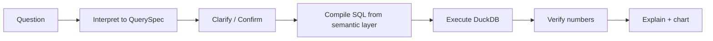

# Pantree Insights Agent

An AI data analyst that answers business questions with verified numbers. The LLM never writes SQL.
A large language model (LLM) interprets the question; Python builds the query and checks its numeric claims.

[Open the live demo](https://pantree-insights-um7bylhdra-uc.a.run.app/) · [Dataset and AI settings](docs/ai-settings.md)

<!-- Demo recording placeholder: docs/demo.gif. Add an actual recording before embedding it. -->

| Example question | Answer excerpt | Local median time |
| --- | --- | --- |
| What was yesterday's GMV? | Gross sales: ₹75,757.00 | 0.199 s |
| What is the monthly return rate? | Latest observed month (2026-11): 18.01% | 0.406 s |
| Show revenue by category. | Highest: Apparel — ₹12,622,125.87 | 0.530 s |
| Which brands generated the highest sales? | Highest: Puma — ₹1,756,918.27 | 0.509 s |

Examples use the small snapshot through 2026-11-22. Times are three-pass local medians for model-free paths, excluding startup and human confirmation; they are not live-demo response times.

## Why it matters

- Generated SQL can run successfully while answering the wrong business question.
- Shared metric definitions and join checks catch unsupported calculations before execution.
- A visible plan and checked numeric evidence make the answer easier to inspect and challenge.

## How it works



A QuerySpec is a structured request describing measures, filters, groups, and dates.
The semantic layer is a collection of YAML files defining those business terms.
Every query needs confirmation. Follow-up questions retain the approved context.

## Results

The latest paid evaluation (22 November 2026, code `1df31b0`) used the same 100 questions as the previous run (seed 20261122): 56 answer cases and 44 behavior cases. It ran twice: once in autonomous mode and once in user mode. In autonomous mode, plans are confirmed blindly and the agent's questions go unanswered. In user mode, a simulated business user also picks one of the options the agent offers.

| Measure | Previous run (autonomous) | Latest, autonomous | Latest, user mode |
| --- | --- | --- | --- |
| Correct answer tables | 27/56 (48.2%) | **49/56 (87.5%)** [78.5–94.7%] | 47/56 (83.9%) [75.0–92.9%] |
| Verified-labelled answers matching gold | 27/34 (79.4%) | 49/51 (96.0%) | 47/52 (90.3%) |
| Verified-labelled reference mismatches (silent wrong) | 7 | 2 | 5 |
| Refusals of unsafe requests | - | 12/12 | 12/12 |
| Vague questions correctly clarified | - | 5/6 | 5/6 |
| Token cost (ceiling $4) | $0.64 | $0.87 | $0.82 + $0.13 held for unconfirmed calls |

Square brackets are 95% bootstrap intervals. In both modes the regression scores use the column rubric fixed before the latest run: each question lists the columns it asks for. On the previous run's saved answers, that rubric alone turns 4 of its 29 failures into passes; the remaining gain comes from the code changes.

The release gate (every answer correct, no silent wrong answers) still fails. Remaining failures:
- **Fixed after this run, not yet re-measured:** x11, a malformed contrast reading; z01, a declined period with no data.
- **Plain ambiguity:** m10, h10 and a follow-up.
- **Wrong row counts:** c24 and m11, by region and top 10.
- **Provider errors in user mode:** two calls the provider didn't confirm; the paid run allows no retries.

Reports: [autonomous](evals/reports/2026-11-22/autonomous/results.md), [user mode](evals/reports/2026-11-22/user/results.md), and the [previous run](evals/reports/current/results.md).
These are simulated-data results from one repeat. Narrative faithfulness is not measured.

## Tech stack

Python · LangGraph · Pydantic · DuckDB · SQLAlchemy/PostgreSQL · FastAPI · JavaScript ES modules · Cloud Run

## Quickstart

Requires Python 3.11+ and [uv](https://docs.astral.sh/uv/). These three commands open the app and its model-free demos.

```bash
uv sync --locked
uv run pantree-data download --size small
DATA_SIZE=small uv run pantree-web
```

For live model questions, configure the provider securely as described in [the settings guide](docs/ai-settings.md).
Never commit a provider key. [Deployment guide](docs/deploy.md) · [Evaluation commands](evals/README.md)

## Limitations

- Data is simulated; results do not describe a real business.
- Verification checks numeric evidence, not every interpretation, narrative claim, or causal explanation.
- Investigations and retrieved history have explicit bounds; unsupported scope needs clarification or a new query.
- Active jobs run on one instance; distributed workers and a concurrent-user benchmark are not implemented.

[Architecture](docs/ARCHITECTURE.md) · [Design decisions](docs/DESIGN_DECISIONS.md) · [Implementation history](docs/history/README.md)

MIT license.
