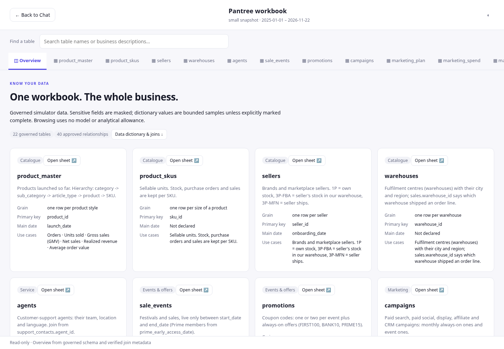
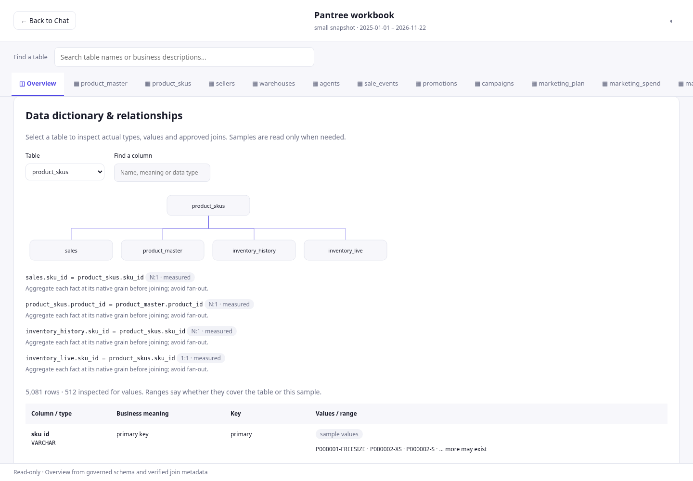
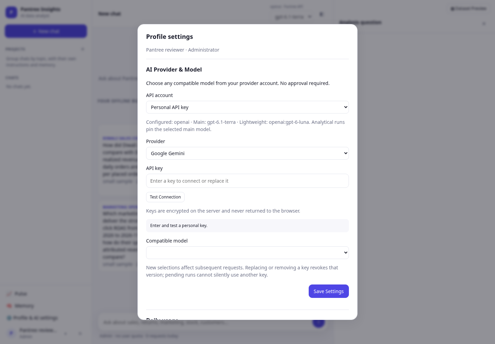

# PR #41 validation and implemented screens

Baseline: main after PR #40, `a0831fd0d8dc269f6bb8da79d2e9f181fdbb7125`.
Branch: `feature/dataset-provider-settings`. Local evidence was collected on 22 November 2026 using
Python 3.12, PostgreSQL 17 and the small simulator snapshot (seed 42, 2025-01-01 through 2026-11-22).
No production deployment or billable provider inference was performed.

## Delivered behavior

- Full-screen workbook above Analysis, with Overview plus 22 dynamically discovered governed sheets,
  40 declared relationships, measured cardinalities, additional join conditions, precautions, searchable
  dictionary, actual types and bounded sample values. Thirty actual rows per sheet load lazily. Chat DOM,
  pending confirmation and ongoing streams survive browsing. Sensitive/authentication values are masked;
  blocked tables/columns cannot be requested. Metadata and preview caches follow snapshot identity.
- Four provider adapters, account-specific model discovery, encrypted personal keys, connection tests,
  replacement/removal and switching back to shared OpenAI. All users can switch compatible models without
  approval. The header distinguishes the active pinned run from the model selected for future requests.
- A durable per-call ledger with provider/model/credential/billing attribution, input/cached/output tokens,
  estimated cost and uncertain outcomes. Atomic individual plus aggregate dollar reservations prevent
  concurrent shared requests bypassing limits. Administrators and personal accounts are separately tracked
  and exempt from ordinary shared spend limits; existing resource and ordinary request controls remain.
- Admin allowance management and individual/aggregate usage. Immutable run configuration and restored cost
  history survive PostgreSQL checkpoint recovery. Revoked credentials fail explicitly, without fallback.
- Existing interpreter, LangGraph workflow, mandatory confirmation, deterministic SQL compilation,
  analytical verification, conversation context and grounding are unchanged. No approval workflow,
  spreadsheet framework, provider microservice or orchestration redesign was added.

## Evidence

| Check | Result |
|---|---|
| Full local pytest with real PostgreSQL | 1,639 passed; 1 skipped, 122.05 seconds |
| Final provider/security follow-up, including four added partial-usage cases | 22 passed |
| Real PostgreSQL integration, included in full run | 9 passed |
| Existing browser regressions after final UI edits | Passed |
| New workbook/settings browser contracts | Passed: desktop/mobile × light/dark |
| Evaluation gold SQL | 129 valid queries; zero problems |
| Compiler baseline, 98 cases × three passes | 294/294 matched; snapshot unchanged |
| Ruff, whitespace, locked dependency install | Passed |

The single skip is the existing recorded-demo snapshot comparison when its fixture differs from the nightly
simulator snapshot; it is not a skipped provider, budget or PostgreSQL test. The new four partial-usage cases
were added after the full local run and passed in the final 22-test provider follow-up. GitHub CI runs the full
suite, both browser suites, gold validation and compiler comparisons against the submitted branch.

New checks cover encryption and owner binding; replacement/deletion and shared-key rotation; backend model
membership; ordinary/admin authorization; safe validation/provider errors; fixed trusted endpoints; all four
provider wire contracts and cached token accounting; no personal-to-shared fallback; missing/invalid pricing;
partial usage; uncertain reservations; malformed output charging; single settlement under retries; SQLite and
PostgreSQL concurrent limits across users/models; additive migration with preserved spend; and actual
LangGraph pause/restart/resume using the original account/model after settings change.

Workbook checks use real Parquet rows/types/counts and governed joins. Browser fixtures exercise account and
provider workflows without live credentials; the screenshots below use the actual running FastAPI app and
real simulator data, with local test accounts and no provider network mocks or successful-connection claims.

## Actual interface screenshots

The data source is the public, ungated synthetic [Meet58/ecommerce-simulator dataset](https://huggingface.co/datasets/Meet58/ecommerce-simulator).
Screens show a local reviewer test account and no API keys. Screenshot publication to this repository was
explicitly approved by the user. Capture script: `tests/capture_workspace.cjs` with a local signed-in
Playwright storage-state file supplied through `PANTREE_BROWSER_STATE`; never commit that session file.

| Screen | Capture |
|---|---|
| Chat header and Dataset Preview above Analysis | [Desktop chat](screenshots/pr41/chat-desktop.png) |
| Governed workbook Overview | [Desktop overview](screenshots/pr41/overview-desktop.png) |
| Actual sales samples, counts and sticky headers | [Desktop sales sheet](screenshots/pr41/sales-desktop.png) |
| Actual dictionary and measured relationship diagram | [Dictionary and joins](screenshots/pr41/dictionary-desktop.png) |
| Personal provider setup | [Profile settings](screenshots/pr41/settings-desktop.png) |
| Administrator allowances and usage | [Usage management](screenshots/pr41/usage-desktop.png) |
| Responsive workbook in dark theme | [Mobile overview](screenshots/pr41/overview-mobile-dark.png) |
| Horizontally scrollable samples on mobile | [Mobile sales sheet](screenshots/pr41/sales-mobile-dark.png) |

## Limits and operational prerequisites

See [configuration and database migration](ai-settings.md). Personal credentials require a protected Fernet
key. Ordinary shared inference requires configured current pricing for the selected model; unknown prices
never silently become zero. Account model discovery plus supported-family filtering is not proof of live
structured-output support, entitlements, billing balance or analytical accuracy for every model. Connection
tests perform model listing only. These adapters were validated with deterministic HTTP responses, not paid
live calls. Live accuracy, invoice reconciliation and production latency remain outstanding.

Unknown provider outcomes retain conservative holds for that UTC day. Provider invoices remain the source of
truth. The application still follows its existing single-instance run coordination model; database spending
reservations themselves were exercised concurrently. The compiler benchmark measures local SQL execution,
not end-to-end model or production latency. No production data or configuration was changed.
